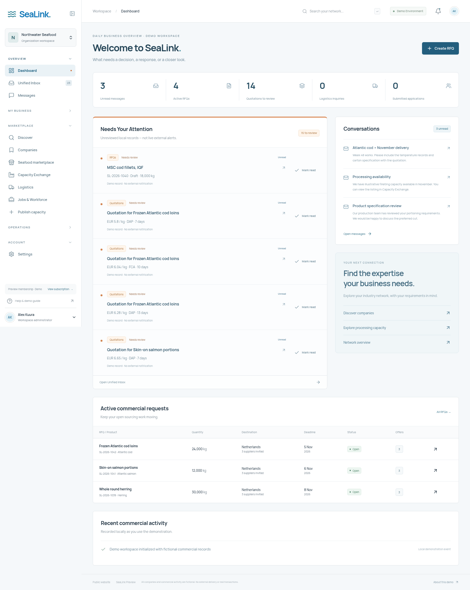
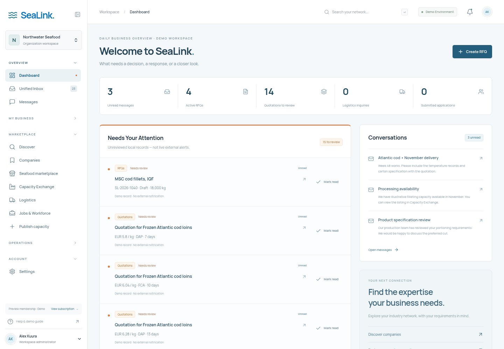
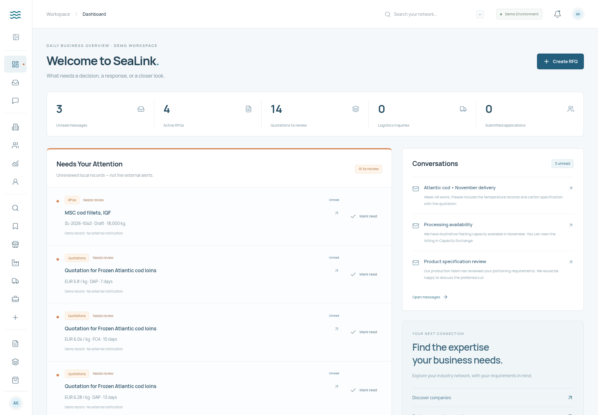
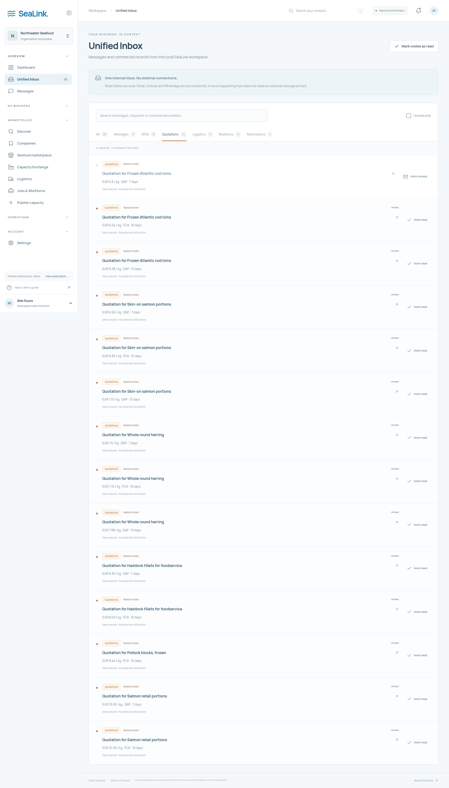
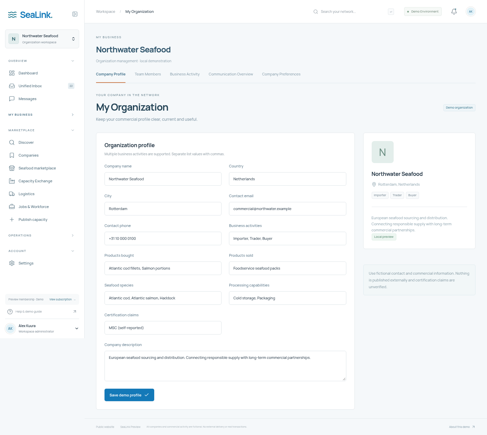
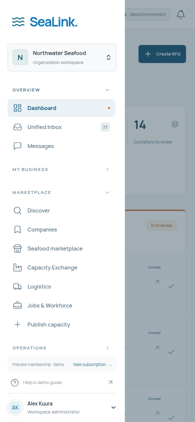

# SeaLink 2.2 review

Built on the premium-redesign branch, preserving the existing application history and workflows. All data shown is fictional and local. No backend or external messaging, team authorization, transport tracking or payment integration is introduced.

## What changed

- Grouped sidebar: persistent expansion, desktop icon-only mode, active route indicators, keyboard controls and mobile focus containment/Escape dismissal.
- Daily business dashboard: Needs Your Attention, unread conversation records, active sourcing, quotation, logistics and workforce counts and local commercial activity.
- Unified Inbox: typed projection of existing records, category filters, search, priority context, per-item read/unread controls, mark-visible-as-read and persistence.
- Company management: existing profile editor plus team directory, business overview, communications and company preferences.
- Orders/Shipments: functional local planning notes over awarded RFQs and saved inquiries, explicitly not confirmed orders or shipments.
- Original discovery dashboard preserved at `/app/network-overview`; existing URLs and storage remain available.
- Restrained orange accents and blue/orange public photo treatments. Existing licensed photography is retained. Dedicated industrial-photo replacement is still a sourcing follow-up.

## Verification

ESLint, TypeScript, production build, 14 business-rule tests and 9 Chromium browser tests passed. Tests cover existing sourcing/award/reset workflows, onboarding, logistics, recruitment, capacity, local persistence, inbox behavior, keyboard interaction, compact navigation, responsive overflow, image loading and reduced motion.

The screenshots below were generated by the browser tests against the production build with fictional records. `tests/workspace.spec.ts` records the original captures under `/tmp/sealink22-*.png`.

## Daily dashboard

## Expanded sidebar

## Compact sidebar

## Unified Inbox

## My Organization

## Mobile navigation

